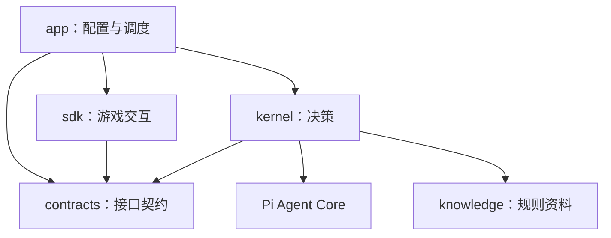

# GameAgent

用一个 TypeScript 仓库连接游戏交互与模型决策。首版已实现模拟游戏 SDK、
Pi Kernel 和 App 调度，无 API Key 也能跑通完整对局。

## 快速运行

需要 Node.js **22.19+**（建议 24）和 npm。

```sh
npm ci
npm start
```

默认使用确定性的双人模拟对局，以及 Pi 自带的离线模型传输。
每次决策仍经过真实的 Pi Agent 工具循环：`query_rules` → `submit_action`。
默认策略在三回合内获胜，终端输出执行结果及日志目录。
这是用于验证程序链路的简化游戏，不是完整三国杀模拟器。

```sh
npm run check                  # 严格类型检查、行为与依赖边界测试
npm run build
node dist/src/app/main.js       # 验证编译产物，仍默认离线
npm run eval -- --games 10      # 比较两种离线策略
npm run format:check
```

## 四层依赖

箭头表示代码依赖。Pi 的类型、模型消息与工具调用仅出现在 Kernel 内。



| 路径                    | 职责                                                  |
| ----------------------- | ----------------------------------------------------- |
| `src/contracts/`        | 框架无关的观测、局面、事件、决策请求、动作和结果      |
| `src/sdk/index.ts`      | 事件订阅、获取状态、动作执行与会话生命周期            |
| `src/sdk/adapters/`     | 游戏接入接口与确定性模拟器；截图、协议接入的扩展约定  |
| `src/sdk/state.ts`      | 观测校验、乱序过滤、统一局面和状态版本                |
| `src/sdk/requests.ts`   | 创建、去重、替换、消费和失效决策请求                  |
| `src/sdk/executor.ts`   | 动作校验、一次性派发、超时与确认                      |
| `src/kernel/index.ts`   | 接收事件、发起/取消决策、接收执行结果                 |
| `src/kernel/runtime.ts` | 创建和配置 Pi Agent，管理模型消息、用量及取消         |
| `src/kernel/context.ts` | 从游戏记忆选择当前上下文，检索规则                    |
| `src/kernel/memory.ts`  | 完整对局事件、事实、执行结果、带置信度的身份/手牌推测 |
| `src/kernel/tools/`     | `query_rules` 与只记录选择的 `submit_action`          |
| `src/kernel/prompts/`   | 系统提示词和出牌/响应场景模板                         |
| `src/app/`              | 配置、程序入口、请求调度和运行日志                    |
| `knowledge/`            | 明确限定为模拟器的结构化规则资料                      |
| `tests/`                | 状态、请求、执行、取消、记忆与完整链路测试            |
| `evals/`                | 策略比较和指标输出                                    |
| `runs/`                 | 自动生成的事件、决策、模型记录和汇总；不提交 Git      |

### 动作边界

Kernel 返回本项目定义的 `Action`。模型只能选择请求中的合法选项 ID，
`submit_action` 将其转换为动作并保存在本次决策中，不持有 SDK 或适配器。
App 执行以下流程：

```ts
const action = await kernel.decide(request, signal);
const result = await sdk.execute(action, signal);
kernel.observeResult(result);
```

SDK 会重新校验游戏 ID、请求 ID、状态版本、截止时间与完整动作内容。
同一个 Action ID 的并发/重复调用复用结果；同一窗口即使换 Action ID
也只能派发一次。动作发送后若确认超时、取消或回执不匹配，返回 `unknown`，
不宣称成功，也不自动重试。

### 请求生命周期

只有当前玩家的有效决策窗口会创建请求。相同局面的新观测不会增加版本，
重复与乱序观测被忽略。局面改变会令旧请求失效，必要时创建新请求；
已经执行或关闭的窗口不能被重新打开。

App 串行处理有效请求，队列等待时间计入决策预算。失效、超时和停止会
取消 Pi 决策；即使旧决策忽略取消并迟到返回，它的动作也不会执行。
SDK 单独限制执行确认时间（默认 2 秒），同时遵守游戏窗口的截止时间。
真实接入中应由适配器持续提供最新局面，而不是重复发送未确认的动作。

### 记忆边界

`GameMemory` 按游戏保存完整事件和事实；身份、手牌推测单独存储置信度与证据，
不会自动成为事实。首版不自动推断身份或手牌。
`context.ts` 每次选取最近 20 条事实和最近 5 条结果，并附上相关规则。
`runtime.ts` 为每个请求创建新的模型对话，只保留最近一次模型消息；清除或
压缩模型对话不会删除游戏记忆。完整模型与工具记录写入运行日志。

## 真实模型配置

默认提供商为 DeepSeek，从进程环境读取 `DEEPSEEK_API_KEY`。
已经配置该全局环境变量时，直接运行：

```sh
npm run start:live
```

`start:live` 显式启用真实模型，即使 `.env` 中设置了离线模式。
普通 `npm start` 仍默认离线，不会仅因存在密钥而自动发起 API 调用。

默认模型为 `deepseek-flash`，通过 Pi 自带的 DeepSeek 提供商连接
[`https://api.deepseek.com`](https://api-docs.deepseek.com/)。
真实模式使用模型工具选择动作，游戏接入仍是本地模拟器。
缺少所选提供商的密钥或模型不存在会明确失败，不会退回离线策略。
密钥不写入配置文件、对局上下文和运行日志。

如果希望普通 `npm start` 也启用真实模型，可复制 `.env.example` 为 `.env`，设置：

```dotenv
GAME_AGENT_MODE=live
GAME_AGENT_PROVIDER=deepseek
GAME_AGENT_MODEL=deepseek-flash
GAME_AGENT_BUDGET_MS=10000
```

无需将已有的全局密钥复制到 `.env`。Windows 中刚设置的用户环境变量，
需要重新打开终端才能被继承；也可以仅加载到当前 PowerShell 进程：

```powershell
$env:DEEPSEEK_API_KEY = [Environment]::GetEnvironmentVariable("DEEPSEEK_API_KEY", "User")
npm run start:live
```

运行编译产物时，可用 `node --env-file-if-exists=.env dist/src/app/main.js --live`。
Anthropic 仍可通过 `GAME_AGENT_PROVIDER=anthropic`、
`GAME_AGENT_MODEL=claude-sonnet-4-6` 和环境变量 `ANTHROPIC_API_KEY` 使用。

| 环境变量               | 默认值           | 含义                                                      |
| ---------------------- | ---------------- | --------------------------------------------------------- |
| `GAME_AGENT_MODE`      | `offline`        | `offline` 或 `live`                                       |
| `GAME_AGENT_PROVIDER`  | `deepseek`       | `deepseek` 或 `anthropic`                                 |
| `GAME_AGENT_MODEL`     | `deepseek-flash` | 所选提供商的模型 ID；Anthropic 默认为 `claude-sonnet-4-6` |
| `GAME_AGENT_BUDGET_MS` | `10000`          | 每次决策的最大时间，包含排队                              |
| `GAME_AGENT_RUNS_DIR`  | `runs`           | 运行记录根目录                                            |
| `GAME_AGENT_TURNS`     | `3`              | 模拟对局回合数，1–1000                                    |
| `GAME_AGENT_STRATEGY`  | `prefer_attack`  | 离线模式可选 `first_legal` / `prefer_attack`              |

Pi 依赖固定版本并由 lockfile 锁定，采用当前的
[`@earendil-works/pi-agent-core`](https://github.com/earendil-works/pi/tree/main/packages/agent)
包。扩展其他提供商只需要修改 Kernel 的运行时配置。

## 日志和评估

每次运行创建独立目录，包含：

- `events.jsonl`：观测、决策请求、失效通知和执行结果；未来截图通过路径关联。
- `decisions.jsonl`：决策状态、耗时、Token 和费用。
- `model.jsonl`：模型消息和工具调用记录。
- `summary.json`：对局是否完成、胜者、成功动作数、超时与成本。

`.env`、`runs/`、依赖和构建产物都被 Git 忽略。
进程收到 Ctrl+C 会取消当前请求并停止适配器。
对局未完成时命令返回非零退出码。

评估报告完成率、胜率、超时率、平均耗时、输入/输出 Token 和成本。
默认评估始终离线，不受环境中的 API Key 影响。离线 Token 是合成数据、
费用为零；模拟胜率不能代表真实模型水平。真实模式记录提供商 Token 用量，
费用取 Pi 返回的账单值或目录估算。详情见 [evals/README.md](evals/README.md)。

截图识别、鼠标操作、真实游戏协议、完整规则库和真实模型对局评估尚未实现。
后续按 [适配器约定](src/sdk/adapters/README.md) 扩展接入，保持四层边界。
